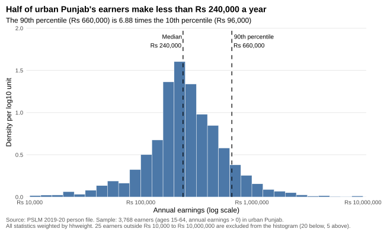
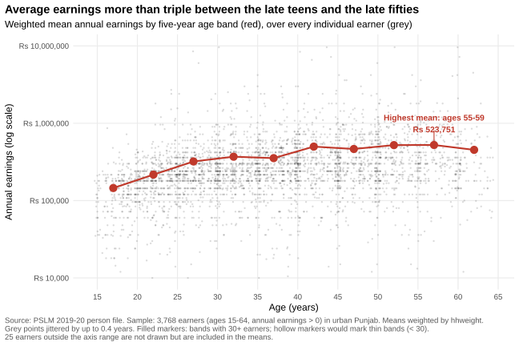
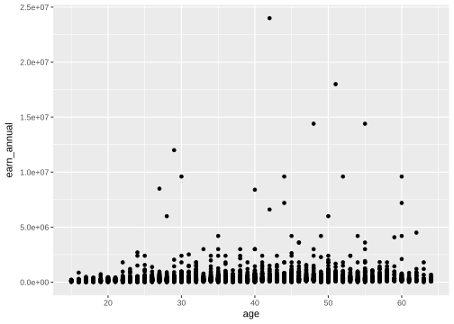
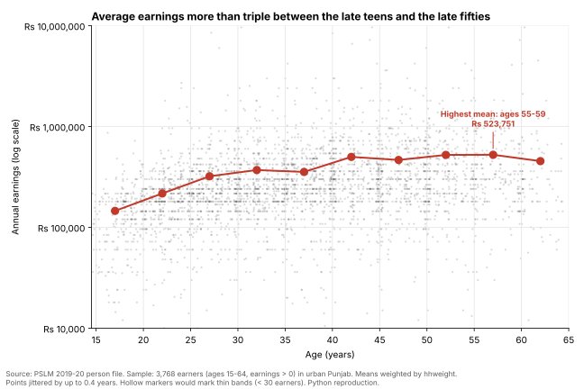

# ECO346 Assignment 1 — FA24-BED-001

**Variant 1: Punjab, urban** (registration number ends in 01; 1 ÷ 8 leaves remainder 1).
Data: PSLM 2019–20 person file, joined to the household file by `hhid` for `hhweight`, `prov_code` and `urban_rural`.
Sample: persons aged 15–64 with annual earnings above zero (earners). All statistics are weighted by `hhweight`.

## How to reproduce

Open `ECO346-A1-FA24-BED-001.Rproj` in RStudio (this sets the working directory to the project root), then run the scripts in order:

| Script | Produces |
|---|---|
| `scripts/01_prepare.R` | `outputs/analysis_data.csv`, `outputs/q2_numbers.csv`, `outputs/q3_band_table.csv` |
| `scripts/02_default.R` | `figures/default.svg` (Question 4, R defaults) |
| `scripts/03_distribution.R` | `figures/q2_distribution.svg` (Question 2) |
| `scripts/04_age_redesign.R` | `figures/q3_earnings_by_age.svg` (Questions 3 and 4) |
| `scripts/05_python_check.py` | `outputs/q3_band_table_python.csv`, `figures/q3_earnings_by_age_python.svg` (Question 5) |

R packages: `readr`, `dplyr`, `ggplot2`, `svglite`. Python packages: `pandas`, `numpy`, `matplotlib`; run from the project root with `python scripts/05_python_check.py`. Everything reads the local files in `data/`, so no internet connection is needed.

## Question 2: the distribution

| | |
|---|---|
| Number of earners | 3,768 |
| Weighted median | Rs 240,000 |
| Unweighted median | Rs 240,000 |
| Weighted 10th percentile | Rs 96,000 |
| Weighted 90th percentile | Rs 660,000 |
| 90th / 10th ratio | 6.88 |
| Excluded from histogram (outside Rs 10,000–10,000,000) | 25 (20 below, 5 above) |

Earnings are roughly bell-shaped on a log scale, so in rupees they are strongly right-skewed: most earners fall between Rs 100,000 and Rs 1,000,000, with a thin tail above. The weighted and unweighted medians are both Rs 240,000 because earnings are heaped at round monthly amounts: 7% of earners report exactly Rs 240,000 (Rs 20,000 a month). Weighting moves the cumulative share by less than one percentage point, not enough to leave that heap.

## Question 3: earnings and age

| Band | Earners | Weighted mean earnings (Rs) |
|---|---:|---:|
| 15–19 | 229 | 145,444 |
| 20–24 | 449 | 216,585 |
| 25–29 | 499 | 320,776 |
| 30–34 | 518 | 369,580 |
| 35–39 | 498 | 354,031 |
| 40–44 | 435 | 498,966 |
| 45–49 | 427 | 465,073 |
| 50–54 | 363 | 521,949 |
| 55–59 | 220 | 523,751 |
| 60–64 | 130 | 453,067 |

No band is thin (all have 30 or more earners).

- Weighted mean, 25–29: **Rs 320,776**
- Weighted mean, 45–49: **Rs 465,073**
- Band with the highest weighted mean: **55–59 (Rs 523,751)**

Mean earnings follow a concave age–earnings profile, as human-capital theory predicts. They rise fastest from 15–19 (Rs 145,444) to 30–34 (Rs 369,580) as workers gain experience, then grow slowly, peak at 55–59 (Rs 523,751) and dip at 60–64. The grey cloud shows that the spread within each age band is far larger than the differences between bands. Because the figure is a single 2019–20 cross-section, it cannot separate age effects from cohort effects: it does not show how any one person's earnings change as they grow older.

## Question 4: the makeover

| R default | Redesign |
|---|---|
|  |  |

1. **Log scale.** In the default, a few earners above Rs 10 million squeeze everyone else into the bottom strip. A log scale spreads them out and shows proportional differences.
2. **Overplotting.** Ages are whole years, so the default stacks points into solid columns. Jitter (±0.4 years) and transparency (alpha 0.2) let density show through.
3. **Conditional means.** Weighted band means, drawn as large markers joined by a line, put the main message on a common position scale, the channel read most accurately in the Cleveland–McGill ranking.
4. **Data–ink.** I removed the grey background, labelled axes in rupees instead of `2.5e+07`, and added a title stating the finding.

What the redesign hides: the extreme earners. The default shows the five earners above Rs 10 million (up to Rs 24 million) and how far, in absolute rupees, they sit from everyone else. The redesign drops them from the axis.

## Question 5: second language (Python)

- 25–29 band mean from R: **Rs 320,776**
- 25–29 band mean from Python: **Rs 320,776**

All ten band means agree to the rupee; the script checks this and prints `True`.

One default that differed was the log-axis labelling. Matplotlib's default log axis prints powers (10⁴, 10⁵) and adds unlabelled minor ticks. I used `FixedLocator` and `FuncFormatter` to print "Rs 10,000" … "Rs 10,000,000" and removed the minor ticks, matching the labels I set in R. I also set marker size, transparency and jitter (±0.4) to match the R figure.
